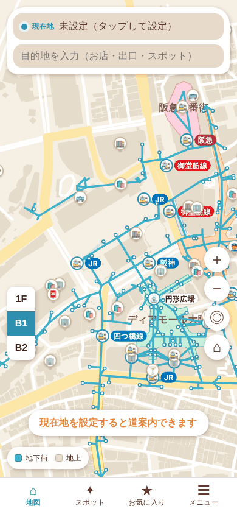
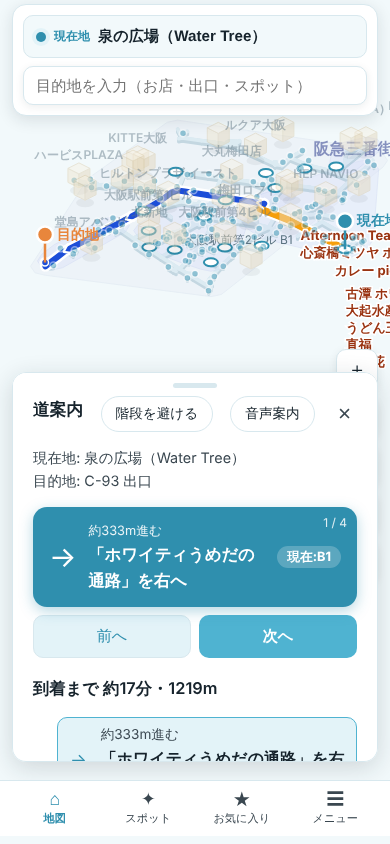

# 梅田地下ナビ / Umeda Underground Navi

**公開URL: https://naki0227.github.io/umeda_underground_map/**

梅田の地下街（ホワイティうめだ・ディアモール大阪・阪急三番街・ekimo梅田・ドーチカと駅の連絡通路）専用の道案内 PWA。
地下では GPS が使えない前提で、**入口や近くに見えるお店から現在地を一度だけ推定**し、以降は静的な経路案内を表示する。
ずれたら「迷った」で推定し直す。地図はアイソメトリック（立体俯瞰）で、地上の建物と地下通路の上下関係が分かる。

<p>
  
  
</p>

## 使い方

1. **目的地を探す**: 上の検索欄に店名・出口番号（例: `H-8`）・地上のスポット（例: `HEP FIVE`）を入れる。地図のピンや建物をタップしてもよい
2. **「ここへ行く」**: 現在地が未設定なら、現在地の確認シートが開く
3. **現在地を確認する**: よく使う目印のチップ、入った出入口、近くに見えるお店（店名で検索）を選んで「現在地を推定する」→「この位置で案内開始」
   - 位置情報が使える場合は、起動時に一度だけ大まかな位置を地図に出す（追跡はしない）
4. **道案内**: 「次へ / 前へ」で次の動作を確認。地図は今の区間に寄り、通り沿いの店名が出る
   - 「階段を避ける」「音声案内」の切り替え
   - 地上を歩いた方が近い場合は Google マップの徒歩ルートへのリンクが出る
   - ずれたら「迷った」、着いたら「終了」
5. **タブ**: 地図 / スポット（地上の目印）/ お気に入り（端末内に保存）/ メニュー（言語・誤りの報告・データの出典）

対応言語: 日本語・English・简体中文・한국어（地名・店名は日本語・英語のデータのみ。中国語・韓国語では英語表記）

## 誤りの報告

お店や出口の情報が実際と違う場合は、アプリの **メニュー → 間違いを報告する** から Google フォームで送る。
報告の扱い方は [docs/DEPLOY.md](docs/DEPLOY.md#4-誤り報告フォームの管理) を参照。

## 設計方針

- **オフラインファースト**: マップはグラフ構造の静的データとしてバンドル。経路探索（Dijkstra）・位置推定はすべてクライアント側で完結し、地下の電波状況に依存しない。PWA（Service Worker）でキャッシュ
- **位置は常時追跡しない**: GPS は起動時・ボタン押下時・位置確定時の単発取得のみ。主材料は「近くに見えるお店」の選択
- **データはスナップショット**: `dataVersion`（OSM の抽出日）をメニューに表示し、誤りはフォームから報告してもらう
- **個人情報を送らない**: 位置情報・お気に入り・言語設定は端末内だけで使う

## アーキテクチャ

```
src/
  domain/     グラフ・経路探索・位置推定・案内文・地上ルート判定・座標変換（純粋TS、UI非依存）
  data/       マップデータ（generated/ は OSM から生成、officialShops.ts は公式サイト掲載の店）
  i18n/       言語資源（ja / en / zh / ko）とヘルパー
  features/   画面単位の UI（map / locate / route / search / spots / favorites / menu / navigation）
  components/ 汎用 UI（ボトムシート・タブバー・言語切替・報告リンク）
  app/        設定値（報告フォーム URL・徒歩速度・PWA マニフェストなど）
scripts/osm/  OpenStreetMap からマップデータを生成するスクリプト
docs/         完成の定義（COMPLETION.md）・公開手順（DEPLOY.md）・TODO・作業報告書
```

## 開発

Node.js 22 を使う。

```bash
npm ci
npm run dev           # 開発サーバー
npm test              # ユニットテスト（vitest）
npm run typecheck     # 型チェック
npm run lint          # oxlint
npm run format        # prettier で整形（CI は format:check）
npm run build         # 本番ビルド（PWA 生成込み）
```

CI（GitHub Actions）で PR ごとに typecheck / format check / lint / test / build を検証する。

マップデータを更新するときは [scripts/osm/README.md](scripts/osm/README.md) の手順で再生成する。

## 公開

main へのマージで GitHub Pages に自動デプロイされる。手順・オーナーの作業（Pages 設定、独自ドメイン、報告フォーム）・ロールバックは [docs/DEPLOY.md](docs/DEPLOY.md) を参照。

## ライセンス

- マップデータ（`src/data/generated/`）: ODbL 1.0（下記「データの出典とライセンス」）
- コード: [MIT License](LICENSE)

## データの出典とライセンス

| データ                                                                   | 出典                                                                                                                                        | ライセンス                                                 |
| ------------------------------------------------------------------------ | ------------------------------------------------------------------------------------------------------------------------------------------- | ---------------------------------------------------------- |
| 通路・出口（番号・位置）・地下の店・駅ビルの店（階）・地上スポットの位置 | © [OpenStreetMap contributors](https://www.openstreetmap.org/copyright)（2026-10-20 抽出）                                                  | [ODbL 1.0](https://opendatacommons.org/licenses/odbl/1-0/) |
| 店名の一部（OSM にない公式サイト掲載の店）                               | 各地下街の公式サイト（ホワイティうめだ・ディアモール大阪・阪急三番街・ekimo梅田・ドージマ地下センター）の掲載情報（店名などの事実情報のみ） | —                                                          |
| 改札・広場・区画の名前と一部の位置                                       | 手作業（`scripts/osm/overlay.mjs` に根拠を記載）                                                                                            | —                                                          |

- `src/data/generated/` は OSM の派生データベースなので ODbL で提供する。アプリのメニューにも帰属表示を出している
- 他サイトの画像・地図タイル・ロゴは使っていない（地図はアプリ内で SVG 描画）
- 再生成の手順: [scripts/osm/README.md](scripts/osm/README.md)

## データについての注意

マップは OSM の記載に基づくもので、現地での検証はしていない。出口番号や位置の誤りはアプリ内の報告フォーム、または OSM の修正 → 再生成で直す。詳細は [docs/TODO.md](docs/TODO.md) を参照。
